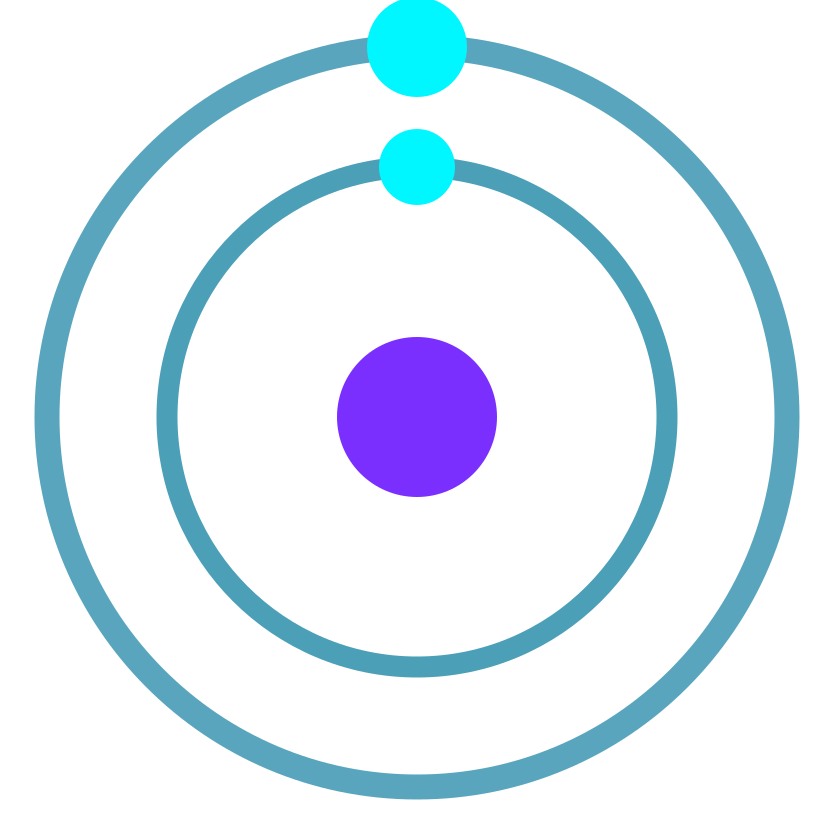

<p align="center">
  
</p>

<h1 align="center"><a href="https://cosmic-diary.infinityfree.io/">Cosmic Diary</a></h1>

<p align="center">
  A space-themed social platform where users write blog entries, build custom planets, follow other explorers, and chat in a global community space.
</p>

---

## Features

- User authentication with bcrypt password hashing
- Captain's Log blog system with image uploads and infinite scroll
- Interactive planet builder with live canvas rendering
- Galaxy gallery with likes and lazy-loaded infinite scroll
- Global chat with replies, mentions, custom emojis, and live updates
- Stories system with 24-hour expiry
- Follow system with private account support and requests
- Notifications with unread badge and favicon indicator
- User profiles with avatars, bios, and activity stats
- Online status and last seen tracking
- Responsive mobile-first design
- PNG and GIF export for planets

## Tech Stack

- PHP 8.2
- MySQL / MariaDB
- Vanilla JavaScript
- HTML5 Canvas API
- CSS3 with custom properties
- Font Awesome 6
- gif.js for GIF encoding

## Requirements

- XAMPP (or any LAMP/WAMP stack)
- PHP 8.0 or higher
- MySQL 5.7 or higher
- Node.js and npm (for local libraries)

## Installation

1. Clone the repository into your web server root:

```
git clone <repository-url> CosmicDiary
```

2. Navigate to the project directory:

```
cd CosmicDiary
```

3. Install Node dependencies:

```
npm install
```

4. Create the database and import the schema:

```
mysql -u root -p cosmic_diary < database.sql
```

>[!TIP]
> The database is exported as schema only. Register a new account to begin.

5. Configure database credentials in `includes/config.php`:

```php
define('DB_HOST', 'localhost');
define('DB_USER', 'root');
define('DB_PASS', '');
define('DB_NAME', 'cosmic_diary');
define('BASE_URL', 'http://localhost/CosmicDiary/');
```

6. Ensure the following directories exist and are writable:

```
uploads/
uploads/avatars/
uploads/stories/
```

7. Start your Apache and MySQL servers and visit:

```
http://localhost/CosmicDiary
```

## Project Structure

```
CosmicDiary/
├── api/              Backend endpoints (JSON responses)
│   ├── auth/         Authentication handlers
│   ├── blog/         Blog CRUD operations
│   ├── chat/         Chat messaging and updates
│   ├── cron/         Activity simulation and maintenance
│   ├── planet/       Planet CRUD and likes
│   ├── stories/      Story creation and viewing
│   └── user/         User profiles, follows, notifications
├── assets/
│   ├── css/          Stylesheets
│   ├── fonts/        Local font files
│   ├── images/       Logos, icons, emojis
│   └── js/           Client-side scripts
├── includes/         Shared PHP (config, header, footer, functions)
├── pages/            User-facing pages
├── uploads/          User-generated content (excluded from git)
├── database.sql      Full database schema
├── package.json      Node dependencies
└── README.md
```

## Security Notes

- Passwords are hashed using bcrypt via `password_hash()`
- All database queries use prepared statements
- Session-based authentication with cookie path scoping
- Input sanitization on all user-submitted data
- File uploads restricted to image types

## License

This project is licensed under the MIT License. See the [LICENSE](LICENSE) file for details.
